# Лабораторная работа №4. Amazon S3 (Часть 1, базовый уровень)

**Студент:** Фулга Влада
**Группа:** IA2404
**Проект:** TimeCapsule
**Регион:** eu-central-1 (Frankfurt)
**Бакет:** `timecapsule-dev-uploads-vlada`


---

## Задание 1. Бакет и объекты в консоли

### 1.1. Создание бакета

Параметры бакета:

| Параметр | Значение |
|---|---|
| Bucket type | General purpose |
| Bucket name | `timecapsule-dev-uploads-vlada` |
| Object Ownership | ACLs disabled |
| Block Public Access | Block all public access (включено) |
| Bucket Versioning | Disable (на этом этапе) |
| Encryption | SSE-S3 |
| Теги | Lab=lab4,  _(остальные обязательные теги из ЛР3)_ |


### 1.2. Загрузка файлов

- Папка `uploads/`: картинка `11-2-cat-png.png` и PDF-файл.
- Папка `backups/`: текстовый файл (config.txt).

> **Скриншот 1.1.** Содержимое папки `uploads/`.
>
> 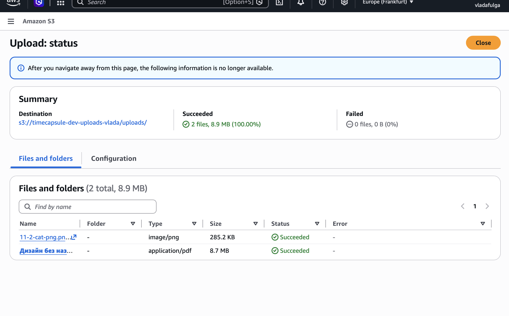

> **Скриншот 1.2.** Содержимое папки `backups/`.
>
> 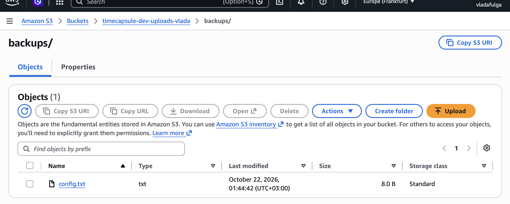

### 1.3. Свойства объекта

| Свойство | Значение |
|---|---|
| Key | `uploads/11-2-cat-png.png` |
| Content-Type | `image/png` |
| ETag | 1ccfa741e474a09ee9de7e8677789284 |
| Object URL | `https://timecapsule-dev-uploads-vlada.s3.eu-central-1.amazonaws.com/uploads/11-2-cat-png.png` |


> **Скриншот 1.3.** Открытие Object URL в браузере (ошибка AccessDenied).
>
> 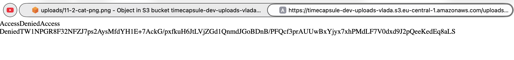

### Ответы на вопросы

**Какой ключ у картинки?**
`uploads/11-2-cat-png.png`. Ключ это полный путь объекта вместе с префиксом `uploads/`. В S3 нет настоящих папок, «папка» это часть ключа.

**Почему Object URL не открывается, хотя я владелец бакета?**
Object URL открывается как анонимный запрос без подписи. Бакет закрыт через Block Public Access, поэтому S3 отказывает всем неаутентифицированным запросам. Быть владельцем недостаточно: запрос из браузера не содержит учётных данных.

**Что на самом деле создала кнопка Create folder?**
Пустой объект размером 0 байт с ключом, заканчивающимся на `/` (например, `uploads/`). Консоль отображает такие объекты как папки.

---

## Задание 2. Объекты из командной строки

Команды выполнялись в AWS CloudShell.

```bash
BUCKET=timecapsule-dev-uploads-vlada
mkdir -p lab4/2026/10 && cd lab4
echo "photo placeholder" > photo.txt
echo "october report"    > 2026/10/report.txt
echo "october report 2"  > 2026/10/report-2.txt
aws s3 cp photo.txt s3://$BUCKET/uploads/photo.txt
aws s3 sync 2026 s3://$BUCKET/uploads/2026
```


### Три варианта `ls`

```bash
aws s3 ls s3://$BUCKET
aws s3 ls s3://$BUCKET/uploads/
aws s3 ls s3://$BUCKET --recursive
```

> **Скриншот 2.1.** Вывод трёх команд `ls`.
>
> 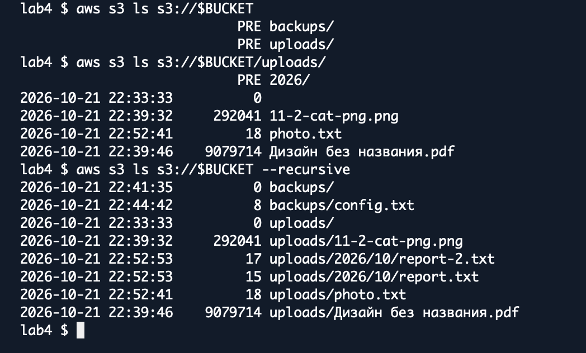

### Метаданные объектов

```bash
aws s3api head-object --bucket $BUCKET --key uploads/2026/10/report.txt
aws s3api head-object --bucket $BUCKET --key "uploads/11-2-cat-png.png"
```

> **Скриншот 2.2.** Вывод `head-object` для `report.txt`.
>
> 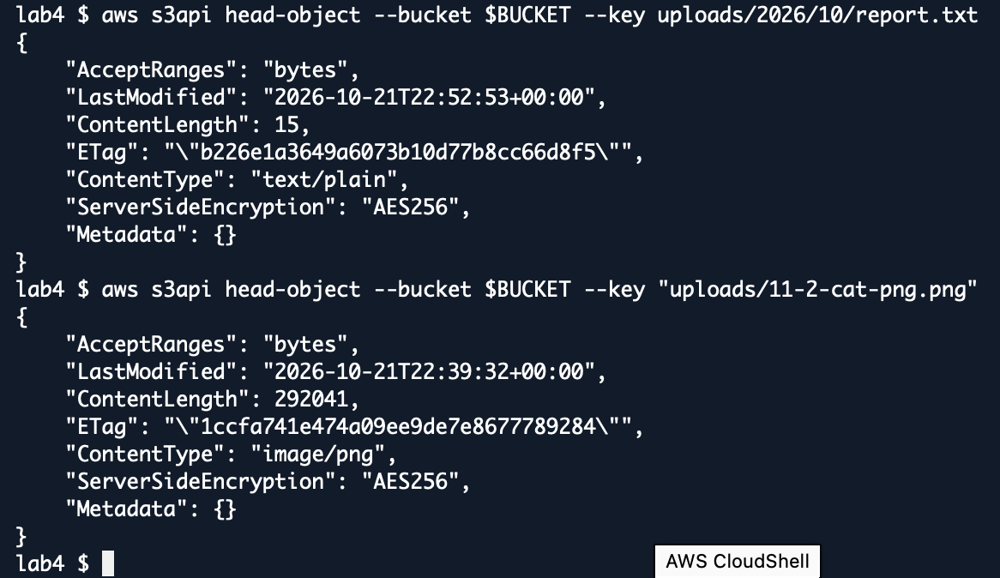


### Скачивание и удаление

```bash
aws s3 cp s3://$BUCKET/uploads/photo.txt downloaded.txt && cat downloaded.txt
aws s3 rm s3://$BUCKET/uploads/2026/10/report-2.txt
```

> **Скриншот 2.3.** Скачивание `photo.txt` и удаление `report-2.txt`.
>
> 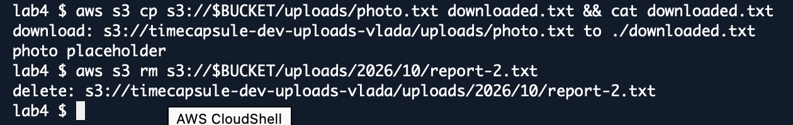

### Ответы на вопросы

**Почему первая команда `ls` показывает `PRE uploads/` и `PRE backups/`, а третья показывает полные ключи?**
Без `--recursive` команда группирует ключи по разделителю `/` и выводит общие префиксы (PRE) как «папки». С `--recursive` группировка не выполняется, и выводятся все объекты с полными ключами.

**Какой Content-Type получил `report.txt`, хотя я его не указывала?**
`text/plain`. AWS CLI определил тип автоматически по расширению `.txt`.

---

## Задание 3. Политика бакета: только HTTPS

Политика бакета (Permissions → Bucket policy):

```json
{
  "Version": "2012-10-17",
  "Statement": [
    {
      "Sid": "DenyInsecureTransport",
      "Effect": "Deny",
      "Principal": "*",
      "Action": "s3:*",
      "Resource": [
        "arn:aws:s3:::timecapsule-dev-uploads-vlada",
        "arn:aws:s3:::timecapsule-dev-uploads-vlada/*"
      ],
      "Condition": {
        "Bool": { "aws:SecureTransport": "false" }
      }
    }
  ]
}
```

> **Скриншот 3.1.** Сохранённая политика на вкладке Permissions.
>
> 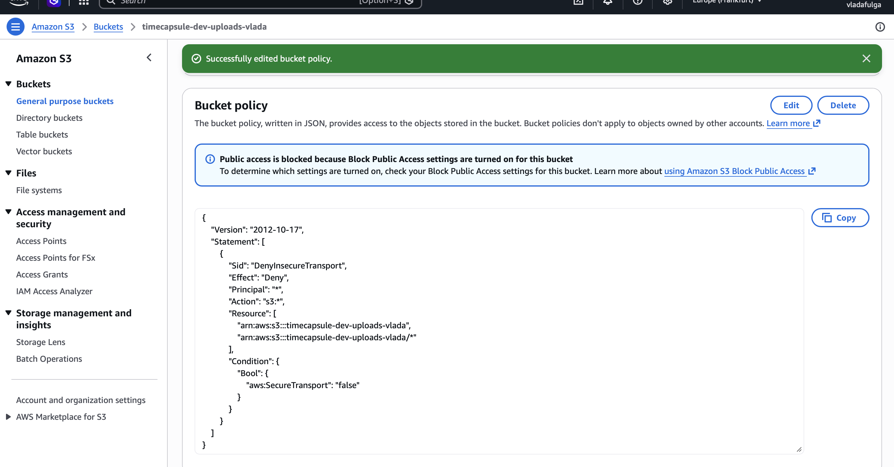

### Проверка

```bash
aws s3 ls s3://$BUCKET/uploads/
aws s3 ls s3://$BUCKET/uploads/ --endpoint-url http://s3.eu-central-1.amazonaws.com
```

> **Скриншот 3.2.** Успешный запрос по HTTPS и AccessDenied по HTTP.
>
> 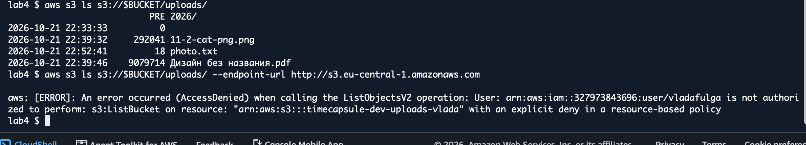

### Ответы на вопросы

**Почему вторая команда получает AccessDenied, хотя у меня права администратора?**
Явный запрет (Deny) в политике всегда приоритетнее любых разрешений (Allow). Запрос по `http://` даёт `aws:SecureTransport = false`, условие Deny срабатывает, и доступ запрещается независимо от прав.

**Почему Block Public Access не помешал сохранить политику с `"Principal": "*"`?**
Block Public Access блокирует политики, которые **предоставляют** публичный доступ. Наша политика только **запрещает** доступ по небезопасному каналу и не делает бакет публичным.

---

## Задание 4. Версионирование и защита от удаления

### 4.1. Включение версионирования

Properties → Bucket Versioning → Edit → Enable → Save changes.

> **Скриншот 4.1.** Показ версий (Show versions): Version ID у файлов, загруженных до включения версионирования (`null`).
>
> 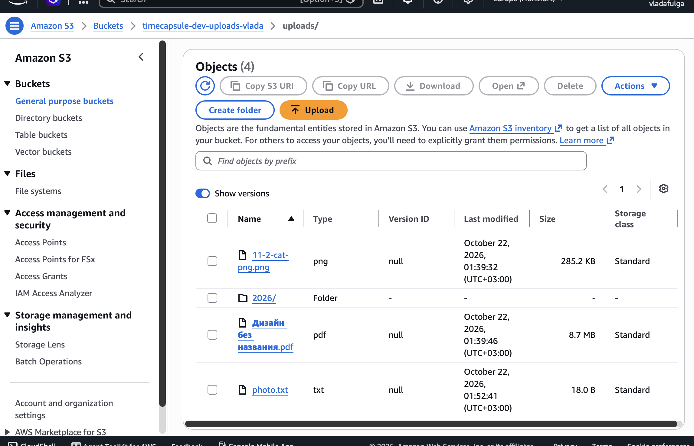

### 4.2. История версий `notes.txt`

Загружены две версии файла `notes.txt` в `uploads/`: с текстом `v1` и затем `v2`.

> **Скриншот 4.2.** Две версии `notes.txt` при включённом Show versions.
>
> 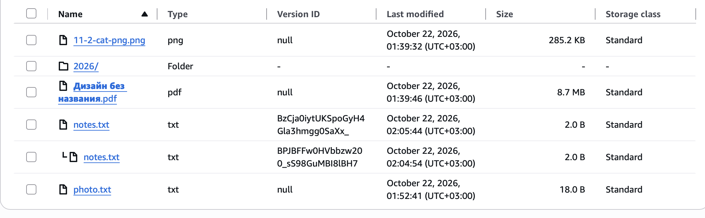

### 4.3. Удаление при включенном Show versions


> **Скриншот 4.3.** Show versions включён: видны две версии и Delete marker.
>
> 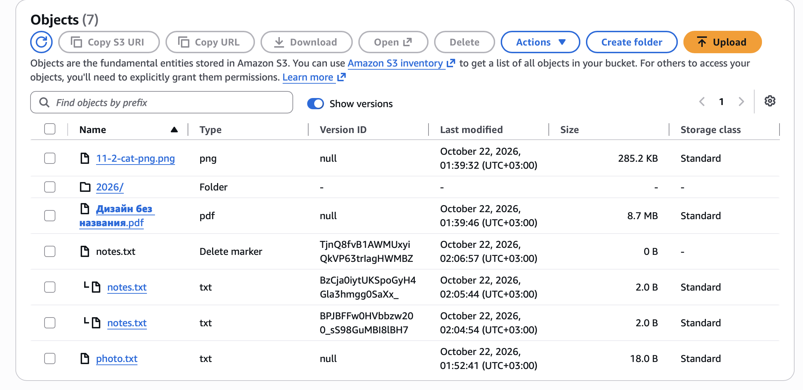

### 4.4. Восстановление

Удалён Delete marker, `notes.txt` вернулся с текстом `v2`.


### 4.5. Откат к v1

Удалена версия `v2` (подтверждение `permanently delete`), текущей стала `v1`.

### Ответ на вопрос

**Чем удаление в шаге 3 отличается от удаления в шаге 5? Какое из них можно отменить? Какой способ защищает от случайного удаления, а какой нужно запрещать приложению?**

- В шаге 3 удаление выполняется без указания версии: S3 лишь добавляет **маркер удаления** (Delete marker), все версии данных остаются.
- В шаге 5 удаляется **конкретная версия** объекта, это окончательное удаление, поэтому консоль требует ввести `permanently delete`.
- Отменить можно только удаление из шага 3: достаточно удалить маркер удаления.
- От случайного удаления защищает первый способ (маркер удаления, данные сохраняются). Второй способ (удаление конкретных версий, `DeleteObjectVersion`) нужно запрещать приложению, чтобы оно не могло уничтожить историю версий.

---

## Задание 5. Правило жизненного цикла

Параметры правила `timecapsule-dev-noncurrent`:

| Параметр | Значение |
|---|---|
| Область действия | Только префикс `uploads/` |
| Переход неактуальных версий | В Standard-IA через 30 дней |
| Удаление неактуальных версий | Через 90 дней, Number of newer versions to retain: 2 |
| Незавершённые загрузки частями | Удаляются через 7 дней |


> **Скриншот 5.1.** Блок Review transition and expiration actions.
>
> 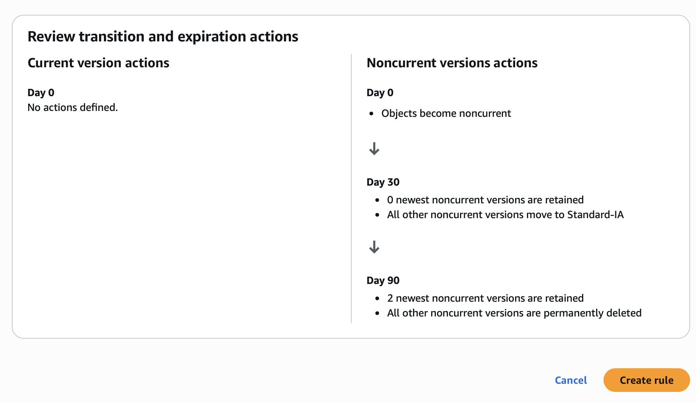


### Ответы на вопросы

**Как поведёт себя правило для файла, который перезаписывали 10 раз за неделю? Какие версии и когда окажутся в Standard-IA, какие будут удалены?**
У файла будет 1 текущая версия и 9 неактуальных. Каждая версия становится неактуальной в момент замены более новой. Через 30 дней после этого момента неактуальные версии переходят в Standard-IA (если они не меньше 128 КБ). Через 90 дней неактуальные версии удаляются, **кроме двух самых новых неактуальных**, они сохраняются. Текущая версия правилом не затрагивается.

**Почему наши маленькие тестовые файлы в Standard-IA не попадут?**
Для Standard-IA минимальный размер объекта 128 КБ. Объекты меньшего размера S3 в этот класс не переводит, так как это невыгодно.

**Что такое незавершённая загрузка частями и почему за неё приходится платить?**
Большие объекты загружаются частями (multipart upload). Если загрузка не была завершена или отменена, уже загруженные части остаются в бакете. Они не видны как объекты, но занимают место и тарифицируются. Правило автоматически удаляет их через 7 дней.

---

## Задание 6. Подписанные URL

### 6.1. Ссылка из консоли (5 минут)

Object actions → Share with a presigned URL → 5 minutes. Ссылка открыта в приватном окне браузера.


> **Скриншот 6.1.** Картинка открылась в приватном окне по подписанной ссылке.
>
> 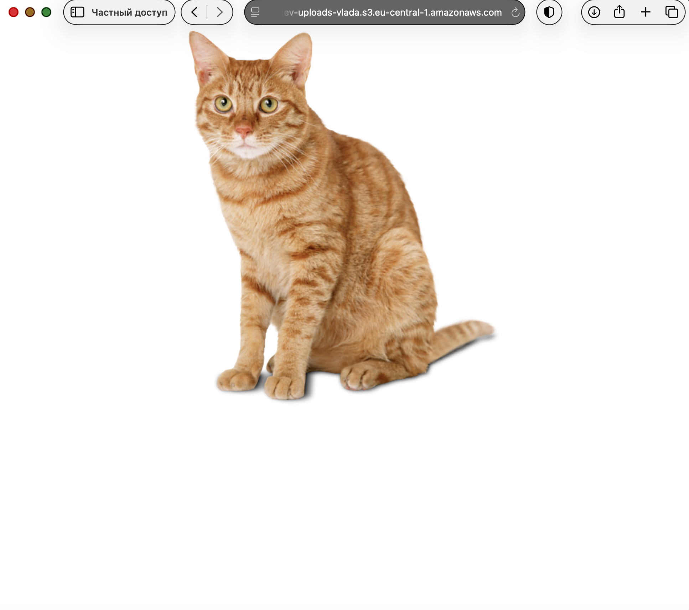

### 6.2. Ссылка из CLI (2 минуты)

```bash
aws s3 presign s3://$BUCKET/uploads/photo.txt --expires-in 120
```


> **Скриншот 6.2.** Открытие ссылки в браузере (содержимое `photo placeholder`).
>
> 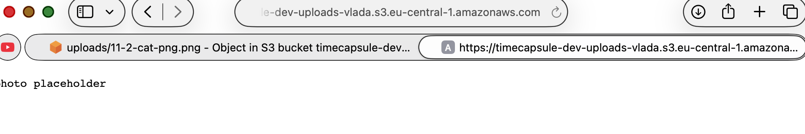


### 6.3. Истёкший срок действия

> **Скриншот 6.3.** Ошибка при открытии исходной ссылки после 2 минут.
>
> 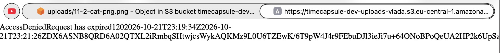

### Ответы на вопросы

**Какие ошибки вернул S3 в шагах 3 и 4?**
- Шаг 3 (подмена ключа): `SignatureDoesNotMatch`.
- Шаг 4 (истёкший срок): `AccessDenied` с сообщением `Request has expired`.

**Почему нельзя получить другой файл, просто поменяв ключ в ссылке?**
Подпись вычисляется от параметров запроса, в том числе от ключа объекта. При смене ключа подпись перестаёт соответствовать запросу, и S3 отклоняет его.

**Обращалась ли команда `aws s3 presign` к S3, когда создавала ссылку?**
Нет. Ссылка формируется локально: подпись считается из учётных данных и параметров запроса без обращения к S3. Поэтому команда сработает даже для несуществующего объекта, а проверка выполняется только при открытии ссылки.

---

## Очистка

После Части 1 удалены временные файлы:

```bash
cd ~ && rm -rf lab4
```


## Вывод

В работе создан закрытый S3-бакет с шифрованием SSE-S3, изучены ключи и метаданные объектов, выполнены операции через консоль и AWS CLI, настроена политика бакета, запрещающая доступ без HTTPS. Включено версионирование и проверены маркеры удаления и откат версий, настроено правило жизненного цикла для неактуальных версий, а также освоена выдача подписанных URL для временного доступа к приватным объектам.
